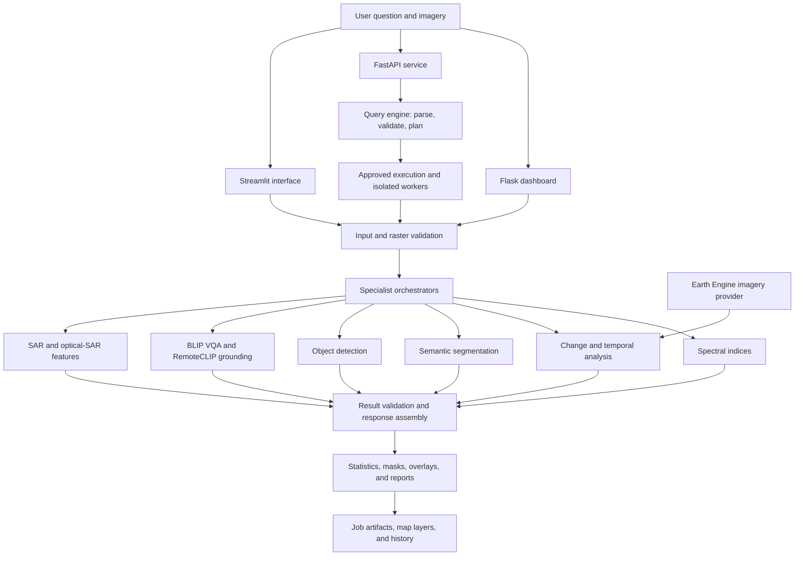

# SatQuery AI

**A vision-language assistant for satellite image analysis.**

SatQuery AI connects natural-language questions to task-specific geospatial analysis, returning measurements, explanations, and visual evidence. It provides a Flask dashboard, a FastAPI service, and a separate Streamlit interface for exploring satellite and aerial imagery.

This is a research and local-development application. Implemented pipelines include spectral indices, land-cover segmentation, vehicle detection, visual question answering, change analysis, and basic SAR processing. Model-dependent features require compatible dependencies and checkpoints; their presence in the code does not establish real-world accuracy.

## Overview

Satellite imagery is useful for studying vegetation, water, urban development, and environmental change, but analysis usually requires knowledge of sensors, spectral bands, coordinate systems, and model inputs. SatQuery AI aims to make these workflows accessible through questions while keeping the underlying evidence visible.

The application validates an image or geographic request, identifies an analysis task, runs the appropriate module, and assembles a response with available statistics and evidence. Its query understanding is primarily rule-based. A vision-language model answers visual questions; it does not autonomously implement arbitrary analysis requests.

## Capabilities

“Implemented” below means an execution path exists in the source, not that it was freshly tested or validated against a scientific benchmark.

| Capability | Input and processing | Output and implementation status |
| --- | --- | --- |
| Natural-language routing | Query text, input roles, targets, and temporal expressions; rule-based parsing and planning | Implemented intent selection, approved tool plans, and routing explanations. Older and newer routers coexist. |
| Spectral analysis | Correctly ordered multispectral arrays; NDVI, NDWI, and NDBI calculations | Implemented index statistics, threshold-based coverage, masks, and visualizations. Ordinary RGB images cannot supply true NIR/SWIR measurements. |
| Change detection | Before/after imagery; spectral differences, task-specific temporal analysis, or the ChangeFormer integration | Implemented masks, changed-pixel statistics, comparisons, and evidence. Choice of path and checkpoint availability matter. |
| Semantic segmentation | RGB image or visual preview; SegFormer B2 trained on LoveDA, followed by class remapping | Implemented water, vegetation, built-up, bare-land, and unknown masks and proportions. Domain transfer remains unvalidated here. |
| Object detection | Aerial RGB imagery; tiled YOLOv8x VisDrone inference, filtering, and duplicate suppression | Implemented supported object detections and annotations. Buildings use semantic segmentation; building counts are estimates rather than verified instances. |
| Visual question answering | Image and natural-language question; BLIP VQA | Implemented answers, runtime telemetry, and caching. Answers can be incorrect and are not substitutes for spectral measurements. |
| Text-guided grounding | Image and target text; RemoteCLIP tile similarity | Implemented experimental spatial relevance maps. Similarity does not establish pixel-level segmentation accuracy. |
| SAR analysis | Band-first radar arrays with VV and, for paired calculations, VH | Implemented backscatter statistics, VV/VH ratios, and linear-power-to-dB conversion. This is not a complete raw-radar calibration or terrain-correction workflow. |
| Optical/SAR fusion | Optical and radar arrays; resizing, normalization, and feature concatenation | Implemented experimental feature tensor and descriptive statistics. Array resizing alone does not establish geographic co-registration. |
| Image classification | Classification labels occur in the legacy router; training utilities exist | No complete standalone classification service is established by the current implementation. The `ai/classification` package is a placeholder. |
| Historical map analysis | Geographic selection and temporal query; Earth Engine retrieval and temporal processing | Implemented map planning, queued jobs, evidence layers, history, and reports. Requires external credentials and suitable imagery. |
| Validation and evidence | File, raster, request, plan, and result checks | Implemented validation contracts, job-isolated outputs, overlays, map previews, and reports; coverage varies by entry point. |

## How it works

1. Supply supported imagery, a before/after pair, or a supported map selection.
2. Ask a question and select the appropriate input mode.
3. Validate file content, input roles, raster properties, and request constraints.
4. Route the request to a supported specialist pipeline.
5. Inspect the answer alongside measurements, visual evidence, provenance, and limitations.

### Architecture



The dashboard and legacy interfaces retain their own execution paths. The API adds typed contracts, policy checks, and isolated worker execution; map jobs also use bounded background execution and SQLite history. These interfaces do not all share identical behavior or storage lifetimes.

## Example questions

| Question | Required input | Expected result type |
| --- | --- | --- |
| “Calculate the vegetation index for this image.” | Multispectral raster with the required band layout | Implemented NDVI statistics and evidence; not a valid request for true NDVI from RGB alone. |
| “Identify regions that have changed between these two images.” | Compatible before/after pair | Implemented change mask, statistics, and comparison imagery; method depends on the selected workflow. |
| “Estimate the proportion of water in this area.” | Suitable image or multispectral raster | Segmentation coverage or threshold-based spectral coverage, depending on routing and mode. |
| “Identify buildings and vegetation in this image.” | RGB imagery | Semantic regions and coverage; building instances are not guaranteed. |
| “Count vehicles in this image.” | Sufficiently detailed aerial RGB image | Detections, estimated count, and annotated evidence; requires vehicle weights. |
| “What is visible in this satellite image?” | RGB image or compatible preview | BLIP visual answer; inspect the source image before relying on it. |
| “Generate a visual representation of the detected regions.” | A supported analysis request and its imagery | Pipelines generate their associated evidence. This wording alone does not guarantee a distinct export intent. |

## Technology stack

| Layer | Libraries and components in the repository |
| --- | --- |
| Languages | Python; HTML, CSS, and JavaScript |
| Interfaces | Flask dashboard; FastAPI/Pydantic/Uvicorn API; Streamlit interface |
| Learning and vision | PyTorch, Transformers, OpenCLIP, Ultralytics, OpenCV, Pillow |
| Numerical and geospatial | NumPy, SciPy, Rasterio, PyProj, Shapely |
| Imagery retrieval | Google Earth Engine through `gee_temporal.py` |
| Persistence | Local job directories and SQLite analysis history |
| Testing | Python `unittest`, executable test modules, and JavaScript map-evidence checks |

Dependency files also contain training and experimental packages. Listing a dependency does not mean every runtime pipeline uses it.

## Repository layout

```text
Satquery_ai/
├── app.py                     # Separate Streamlit interface
├── frontend/                  # Flask app, templates, scripts, and styles
├── backend/                   # FastAPI routes, schemas, jobs, and history
├── query_engine/              # Parsing, planning, policy, execution, validation
├── ai/
│   ├── input_manager/         # Legacy input roles, loading, and metadata
│   ├── validation/            # Image and raster validation
│   ├── router/                # Query planner and specialist orchestrator
│   ├── query_router/          # Earlier keyword router
│   ├── orchestrator/          # Earlier execution pipeline
│   ├── spectral/              # Basic spectral utilities
│   ├── multispectral/         # Sentinel-2 indices and summaries
│   ├── change/                # Spectral and ChangeFormer integrations
│   ├── temporal/              # Temporal reasoning and trends
│   ├── semantic/              # Segmentation analysis
│   ├── models/                # Model loading and SegFormer implementation
│   ├── detection/             # Aerial objects and building estimates
│   ├── vqa/                   # BLIP visual question answering
│   ├── grounding/             # RemoteCLIP relevance maps
│   ├── sar/                   # Radar loading and statistics
│   ├── fusion/                # Optical/SAR feature concatenation
│   └── evidence/              # Visual evidence generation
├── geospatial/raster/         # Raster loading and metadata
├── gee_temporal.py            # Historical imagery retrieval
├── training/                  # Training and detector evaluation utilities
├── tests/                     # Contract, regression, and integration checks
├── scripts/                   # Preflight and release packaging
├── configs/                   # Training configuration
└── external/                  # Optional upstream integrations
```

Datasets, checkpoints, virtual environments, uploads, and `outputs/` are local resources excluded by `.gitignore`; a fresh clone will not include them.

## Prerequisites and environment setup

Use Git and a working Python installation. Earlier project instructions target Windows 10/11 with Python 3.10; the current preflight recommends Python 3.11 or newer for Google client dependencies. A single, freshly verified Python/platform compatibility matrix is not available. Linux/macOS commands below describe equivalent setup, not verified platform support.

CPU execution is available in several model paths; a compatible accelerator can help with large models and tiled inference. No measured minimum RAM, VRAM, or latency guarantee is established. Allow disk space for checkpoints, imagery, and retained job artifacts. Downloads and live map imagery require network access.

### Dependency files

| File | Purpose |
| --- | --- |
| [requirements-runtime.txt](requirements-runtime.txt) | Web/geospatial runtime dependencies; includes backend requirements but not the complete specialist ML stack. |
| [backend/requirements.txt](backend/requirements.txt) | API and HTTP test-client dependencies. |
| [requirements.txt](requirements.txt) | Large pinned ML/development environment snapshot, including optional training packages. |
| [requirements-base.txt](requirements-base.txt) | Separate minimal image/raster snapshot; contains versions different from the main snapshot. |

Do not merge these snapshots indiscriminately. Installing the runtime requirements alone does not enable every model pipeline. Exact dependency resolution and clean installation were not rerun during this documentation review.

### Windows PowerShell

```powershell
git clone https://github.com/Harsha1704/Satquery_ai.git
cd Satquery_ai
py -3.12 -m venv .venv-ml
.\.venv-ml\Scripts\Activate.ps1
python -m pip install --upgrade pip
python -m pip install -r requirements-runtime.txt
```

Python 3.12 here is a setup choice consistent with the preflight recommendation, not a claim that all pinned specialist packages have been validated with it. For the full specialist environment, review the pinned snapshot for your Python, platform, and accelerator, then install it and the runtime requirements together:

```powershell
python -m pip install -r requirements.txt -r requirements-runtime.txt
```

If resolution fails, retain the resolver error and establish a compatible environment; do not silently remove versions and describe the result as a reproduced environment. Existing virtual environments are not portable: recreate them if their original Python installation has moved.

### Linux/macOS shell

```bash
git clone https://github.com/Harsha1704/Satquery_ai.git
cd Satquery_ai
python3 -m venv .venv-ml
source .venv-ml/bin/activate
python -m pip install --upgrade pip
python -m pip install -r requirements-runtime.txt
# For specialist workflows, after reviewing platform compatibility:
python -m pip install -r requirements.txt -r requirements-runtime.txt
```

### Configuration

[.env.example](.env.example) documents local settings. The application reads process environment variables; copying this file to `.env` is not sufficient to establish automatic loading.

| Variable | Purpose / default |
| --- | --- |
| `SATQUERY_INPUT_ROOT` | API input directory; defaults to `frontend/uploads`. |
| `SATQUERY_JOB_ROOT` | Isolated jobs; defaults to `outputs/jobs`. |
| `SATQUERY_HISTORY_DB` | SQLite history; defaults to `outputs/satquery_history.sqlite3`. |
| `SATQUERY_ANALYSIS_TIMEOUT` | Analysis timeout; default `900` seconds. |
| `SATQUERY_MAX_WORKERS` / `SATQUERY_MAX_QUEUE` | Background execution limits; defaults `2` / `6`. |
| `SATQUERY_MAX_REQUEST_BYTES` | API request-body limit; default `2097152` bytes. This is separate from dashboard upload limits. |
| `SATQUERY_CORS_ORIGINS` | Comma-separated allowed browser origins. |
| `SATQUERY_PRELOAD_VQA` | Dashboard BLIP preload; set `0` for first-use loading. |
| `SATQUERY_BLIP_WARMUP` | Set `1` to request warmup inference. |
| `SATQUERY_VEHICLE_WEIGHTS` | Optional absolute path to local vehicle detector weights. |
| `GEE_SERVICE_ACCOUNT_EMAIL`, `GEE_SERVICE_ACCOUNT_KEY`, `GEE_PROJECT_ID` | Earth Engine service-account configuration for live retrieval; the key setting identifies the credential file. |

Set variables in the shell that launches the service, for example `$env:SATQUERY_PRELOAD_VQA = "0"` in PowerShell or `export SATQUERY_PRELOAD_VQA=0` in bash. Use absolute paths for local credentials and weights because workers can run from job-local directories.

## Models and checkpoints

| Pipeline | Source configuration | Setup |
| --- | --- | --- |
| VQA | `Salesforce/blip-vqa-base` | Downloaded through Transformers on first load, or resolved from an existing cache. |
| Semantic segmentation | `wu-pr-gw/segformer-b2-finetuned-with-LoveDA` | Transformers model and processor cache/download. |
| Grounding | `chendelong/RemoteCLIP`, `RemoteCLIP-ViT-B-32.pt` | Hugging Face Hub download; the implementation uses an explicit relative checkpoint cache. |
| Vehicles | `mshamrai/yolov8x-visdrone`, `best.pt` | Hub download or `SATQUERY_VEHICLE_WEIGHTS`. |
| ChangeFormer | External ChangeFormer source and compatible LEVIR checkpoint | Manual source/checkpoint provisioning; see below. |
| Spectral indices and basic SAR/fusion | Numerical operations | No learned checkpoint required for those operations. |

The ChangeFormer integration expects source at `external/ChangeFormer` and, by default, weights at:

```text
external/ChangeFormer/checkpoints/CD_ChangeFormerV6_LEVIR_b16_lr0.0001_adamw_train_test_200_linear_ce_multi_train_True_multi_infer_False_shuffle_AB_False_embed_dim_256/best_ckpt.pt
```

If the source directory is absent, the upstream source URL recorded in `.gitmodules` can be used:

```bash
git clone https://github.com/wgcban/ChangeFormer.git external/ChangeFormer
```

The source clone does not supply the required trained checkpoint. Confirm its provenance, license, and compatibility before placing it at the expected path. Although `.gitmodules` declares this integration, its source is ignored and no tracked ChangeFormer gitlink was present during review; do not assume recursive cloning supplies it. Downloaded models and datasets have their own terms, independent of this repository.

## Run the application

Run commands from the repository root in the configured environment.

```bash
# Terminal 1: FastAPI service
python -m backend.main
```

API documentation: `http://127.0.0.1:8000/docs`.

```bash
# Terminal 2: Flask dashboard
python frontend/app.py
```

Dashboard: `http://127.0.0.1:5000`. The launcher enables Flask debug mode and is intended for local development. Map/API workflows require the API service and, for live retrieval, Earth Engine configuration.

The separate legacy Streamlit interface can be started with:

```bash
python -m streamlit run app.py
```

### API entry points

| Endpoint | Behavior |
| --- | --- |
| `GET /api/v1/health` | Service health; not proof that every model is ready. |
| `POST /api/v1/analysis/plan` | Validate and preview a local analysis plan. |
| `POST /api/v1/analysis` | Synchronous analysis; `/analyses` is an alias. |
| `GET /api/v1/jobs/{job_id}` | Retrieve saved analysis results. |
| `GET /api/v1/jobs/{job_id}/artifacts/{artifact_path}` | Download explicitly published evidence. |
| `GET /api/v1/jobs/{job_id}/report` | Render an HTML report from saved results. |
| `POST /api/v1/map/jobs` | Submit a background map job; returns HTTP 202. |
| `GET /api/v1/map/jobs/{job_id}` | Inspect map-job status. |
| `GET /api/v1/history` | Read persisted analysis history. |

For example, put `sample.png` inside the configured API input root and submit this JSON through `/docs` to `/api/v1/analysis`:

```json
{
  "query": "What is visible in this satellite image?",
  "project_id": "example",
  "inputs": {"image_path": "sample.png"}
}
```

Paths are relative to the input root. Other supported roles include `before_path`/`after_path`, `sar_path`, and `optical_path`. Consult the running OpenAPI schema for endpoint-specific geographic and temporal request fields.

## Use and interpret results

1. Open the dashboard and choose the analysis mode matching your data.
2. Upload one image, a before/after pair, or optical/SAR inputs as required.
3. Enter a concrete question and submit it.
4. Read the response together with the evidence gallery and limitations.
5. For georeferenced results, open Map View to inspect available layers or supported region selections.
6. Open the generated report or download published evidence when available.

The core validator recognizes `.tif`, `.tiff`, `.png`, `.jpg`, `.jpeg`, and `.npy`; acceptance also depends on the interface and selected task. GeoTIFF preserves raster metadata, whereas an ordinary image generally lacks a usable geographic footprint. Recognizing an extension does not make its content suitable for every pipeline.

The multispectral analyzer expects band-first data with at least 12 bands in the Sentinel-2 order `B01, B02, B03, B04, B05, B06, B07, B08, B8A, B09, B11, B12`. The earlier four-band NDVI fixture exercises a different utility and does not establish four-band support in the full Sentinel-2 workflow.

**Vegetation:** NDVI is `(NIR - Red) / (NIR + Red)`. A synthetic red value of `0.40` and NIR value of `0.70` yields approximately `0.2727`. This demonstrates arithmetic, not plant health calibration. NDWI and NDBI likewise require the correct physical bands and preprocessing.

**Change:** A mask with 2,500 marked pixels out of 10,000 represents 25% of that mask's pixel count. It does not independently establish real land-use change or area in square kilometres. Registration, valid-data masks, season, sensor, resolution, and threshold choice affect interpretation.

**Segmentation:** Class proportions summarize model-assigned pixels. The synthetic 45% water fixture validates counting logic, not water-detection accuracy. Unknown pixels and the analysis denominator must be considered.

Routing confidence, similarity scores, and rule-based evidence-quality grades are not calibrated probabilities of scientific correctness. Decorative dashboard examples are not analysis evidence.

## Tests and verification

**Documentation review: 19 October 2026.** Source files and test fixtures were inspected locally. A focused `unittest` run was attempted, but `.venv-ml` could not start because its Python 3.10 executable was missing. The other local environments also referenced missing interpreters. Consequently, no Python tests or fresh dependency installation are claimed as passing in this review.

| Previously reported result | Current evidence and verification status |
| --- | --- |
| 1448 × 1086, three-channel `uint8` PNG ingestion | `tests/test_input_manager.py` loads a local dataset image; dimensions are not fixed in the test. Previously reported, not freshly verified. Its exception handler prints errors, so exit status alone is insufficient. |
| 100 × 100, four-band `float32` GeoTIFF, EPSG:4326 | Fixture construction exists in `tests/test_raster.py`; not rerun. Its synthetic geographic transform is not a realistic metric-area fixture. |
| NDVI minimum/maximum/mean approximately 0.2727 | Consistent with fixture constants and the formula; `tests/test_spectral.py` was not rerun. |
| Spectral, change, and water-segmentation routing | Cases exist in `tests/test_query_router.py`; these exercise the legacy router, not every application route. Not rerun. |
| 10,000 pixels, 2,500 changed, 25% change | Synthetic difference fixture in `tests/test_change_detection.py`; previously reported output, not freshly verified. |
| Water 45%, vegetation 30%, built-up 15%, bare land 10% | Explicit synthetic mask and assertions in `tests/test_semantic.py`; not model predictions and not rerun. |
| Orchestration and generated analysis images | Test modules exist, including `test_orchestrator.py` and `test_evidence.py`; current inference and artifact generation were not rerun. |

After restoring an environment, run a focused regression selection:

```bash
python scripts/preflight.py
python -m unittest tests.test_nlu tests.test_scientific_integrity tests.test_input_validation tests.test_bitemporal_validation_contract -v
python -m unittest tests.test_phase1_api tests.test_phase7_release -v
```

Executable synthetic checks can be run separately:

```bash
python -m tests.test_query_router
python -m tests.test_change_detection
python -m tests.test_semantic
python -m tests.test_evidence
```

To reproduce the raster/NDVI fixture, create `datasets/raw` first, then run `python -m tests.test_raster` followed by `python -m tests.test_spectral`. The raster test writes `datasets/raw/test_multispectral.tif`; use a disposable fixture location if that file already holds valuable data.

Tests mix `unittest` classes, executable functions, synthetic fixtures, model integration checks, and external-service scripts. A single discovery command does not establish that all of these ran. Real-model tests such as `python -m tests.test_vqa_performance` require model dependencies and cached/downloadable weights. Preflight checks files and dependency discovery; it does not validate model accuracy or successful inference.

## Limitations and known issues

- Dependency snapshots differ, and a clean cross-platform installation remains to be verified. Python 3.10 guidance in older documentation differs from the current preflight recommendation.
- Multiple generations of routers, orchestrators, and interfaces remain. Some older documentation describes earlier API behavior; current code includes queued map jobs, artifact serving, HTML reports, and SQLite history.
- Classification, BigEarthNet-related placeholders, and keyword matches must not be treated as complete deployed capabilities. A keyword such as “Landsat” does not imply arbitrary band-layout support in the Sentinel-2 analyzer.
- Model transfer across sensors, resolutions, geography, and seasons has no freshly verified benchmark in this review. Small vehicles and building instances are particularly sensitive to image resolution and method.
- Before/after visual differences can reflect acquisition conditions. Optical/SAR resizing is not equivalent to geospatial alignment.
- Geographic input constraints differ across the legacy analysis API and newer map workflows; arbitrary polygons and date ranges should not be assumed valid everywhere.
- API worker isolation can reload models and create job-local caches. Dashboard caches and legacy in-memory analysis records have different persistence behavior from SQLite map history.
- No authenticated multi-user deployment or production operations setup is established. Local development servers are not a production deployment recipe.

## Security, data handling, and reproducibility

Use the application with trusted local access. Project identifiers are labels, not authorization boundaries. Input-root validation and published-artifact restrictions reduce accidental file exposure but do not replace authentication.

Uploads, job snapshots, evidence, reports, and SQLite history remain on local disk; define retention and deletion practices for sensitive imagery. Model downloads, Earth Engine calls, and external map resources require network access. Keep credential files outside version control and never add tokens, private datasets, or model caches to a documentation commit.

Only load trusted checkpoints: some integrations use `torch.load(..., weights_only=False)`. Record the code revision, Python/dependency versions, model revision or checksum, image provenance, band order, CRS, dates, masks, and analysis thresholds when reproducing results. Current model identifiers do not constitute immutable checkpoint pinning.

## Roadmap

The following are proposed improvements, not commitments or implemented features:

- Publish a tested Python/platform/dependency matrix and automated regression workflow.
- Consolidate legacy routing and orchestration, with consistent contracts across interfaces.
- Validate segmentation, detection, and change outputs on documented held-out geospatial datasets.
- Add explicit sensor/band mapping and stronger co-registration checks.
- Complete or remove placeholder classification integrations.
- Pin model revisions, document checkpoint checksums, and improve worker model reuse.
- Establish authenticated deployment, retention policies, and operational monitoring before multi-user hosting.

## Contributing

Open an issue describing the problem, input characteristics, expected behavior, and reproducible steps. For changes, use a focused branch, preserve unrelated files, and include relevant test results and limitations in the pull request. Clearly identify synthetic fixtures, mocked services, and real-model evaluations. Do not submit credentials, private imagery, downloaded weights, or generated runtime directories.

## License

No root project license file was found during this review. The maintainer needs to select and publish a license; public repository access alone does not establish reuse permission. Third-party models, datasets, and external source code retain their respective licensing requirements.

## Acknowledgments and implementation references

The project integrates BLIP, SegFormer/LoveDA, RemoteCLIP, YOLOv8/VisDrone, ChangeFormer/LEVIR, and Earth Engine alongside the Python geospatial ecosystem. These names identify code dependencies and model configurations, not independently reproduced benchmark results.

For exact integration details, see [VQA](ai/vqa/single_image_vqa.py), [semantic model](ai/models/semantic_model.py), [RemoteCLIP grounding](ai/grounding/remoteclip_grounder.py), [object detection](ai/detection/detector.py), [change detection](ai/change/detector.py), [band configuration](ai/multispectral/band_config.py), and [API application](backend/app/main.py).

### Details needing maintainer confirmation

- Project license and redistribution terms for any supplied artifacts.
- Supported Python/OS/accelerator combinations and a clean, reproducible dependency lock.
- Approved ChangeFormer checkpoint source, checksum, and redistribution permissions.
- Real-data accuracy, hardware requirements, latency, and supported sensor/preprocessing contracts.
- Intended deployment model, authentication, and data-retention policy.
